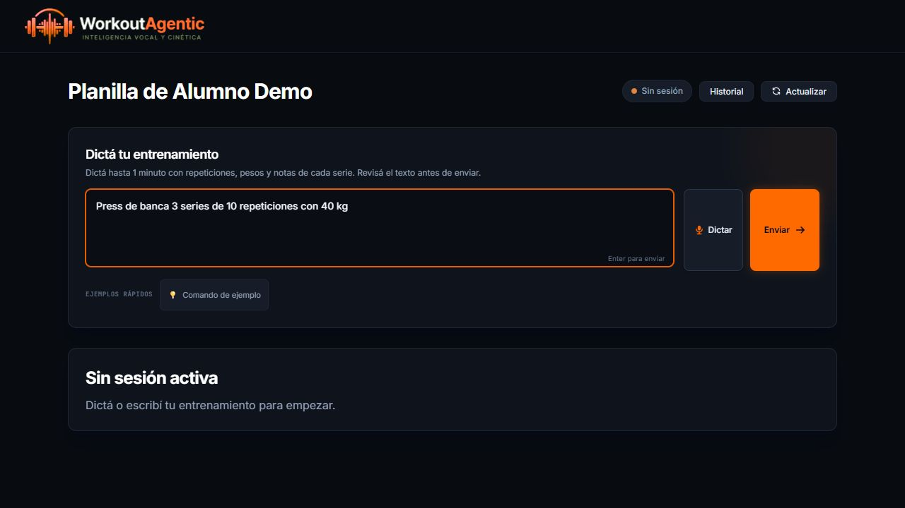

# WorkoutAgentic

A voice and text workout tracker for Spanish-speaking trainees. Describe a workout in everyday language, review the resulting exercise tables, correct individual sets, and confirm a saved workout.

WorkoutAgentic is an actively developed, student-only MVP built with Angular 21 and .NET 10. The UI, language-processing examples, and detailed domain specifications are in Spanish because the product targets Spanish-speaking users, including Rioplatense expressions. This overview and the setup and engineering guides are in English.

## Product flow

1. Type a workout or dictate it using browser speech recognition.
2. Review the recognized text before submitting it.
3. The API interprets the text using Gemini structured output and applies domain rules.
4. Review exercise cards, edit sets, and resolve clarification requests in the same SPA.
5. Confirm an immutable workout snapshot, revisit it in history, and export PDF or Excel.

For example, `Press de banca 3 series de 10 repeticiones con 40 kg` describes an exercise and its sets. More detailed messages can specify different loads and notes for individual sets. Interpretation depends on a configured Gemini model; ambiguous values are not silently guessed.

## Current capabilities

- Text capture and browser dictation, with editable transcripts before submission.
- Multiple sets per message, free-text exercise normalization, and set-specific updates and notes.
- Clarifications and validation that preserve existing records when interpretation fails.
- Inline editing, transactional bulk editing with conflict detection, and row deletion.
- Explicit confirmation, read-only workout history, PDF/Excel downloads, and optional SMTP delivery.
- Dark exercise-card UI, training-completion progress, and installable web-app metadata.

See the [demo walkthrough](docs/demo.md) for screenshots and a review scenario.



## Run locally

Requirements: .NET SDK 10, Node.js 22.12+ in the 22.x line, npm, and a Gemini API key with access to a suitable structured-output model. Browser dictation additionally needs a supported browser and microphone permission.

Follow the [setup guide](docs/getting-started.md) for configuration, explicit student creation, and verification commands. The API runs at `http://localhost:5259`; the SPA runs at `http://localhost:4200` and proxies `/api` to the backend.

## Engineering overview

| Layer | Implementation |
| --- | --- |
| Frontend | Angular 21 standalone components, signals, TypeScript, SCSS |
| Speech input | Browser speech recognition; the application API receives text only |
| Interpretation | Gemini JSON Schema output behind intent/entity interfaces |
| Backend | .NET 10 Minimal APIs organized by feature |
| Persistence | EF Core and SQLite in WAL mode; migrations applied at startup |
| Verification | xUnit API/domain/integration tests; Angular/Vitest tests and ESLint |

The central rule is to never invent workout data. Editable capture records and confirmed snapshots are separate entities. See the [engineering guide](docs/engineering-overview.md) for the interpretation pipeline, state transitions, and trade-offs.

## Scope and next work

This is a local-development MVP. Authentication and per-user authorization are not implemented; the root route temporarily selects student #1. Use synthetic data for evaluation. Browser speech support varies, and SMTP delivery requires separate configuration. Web-app installation metadata does not provide offline capture. WhatsApp and teacher features are outside the current runtime.

Potential next work, subject to product prioritization:

- Add authentication and enforce student ownership across API operations.
- Expand Spanish-language interpretation regression cases and evaluate model quality and latency.
- Validate dictation and installation on real mobile devices.
- Prepare deployment configuration and evaluate PostgreSQL when scaling requires it.

## Repository map

```text
src/api/     .NET API, persistence, migrations, and backend tests
src/web/     Angular trainee SPA and frontend tests
docs/        Setup, demo, domain specifications, architecture, and ADRs
```

Start with [setup](docs/getting-started.md), [demo](docs/demo.md), and [engineering](docs/engineering-overview.md). Detailed Spanish references: [business rules](docs/domain/business-rules.md), [NLU specification](docs/domain/nlu-captura.md), [architecture](docs/arquitectura.md), and [architecture decisions](docs/adr/).
