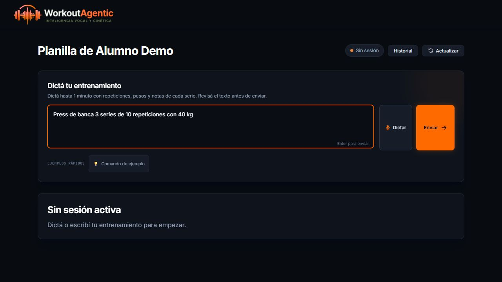
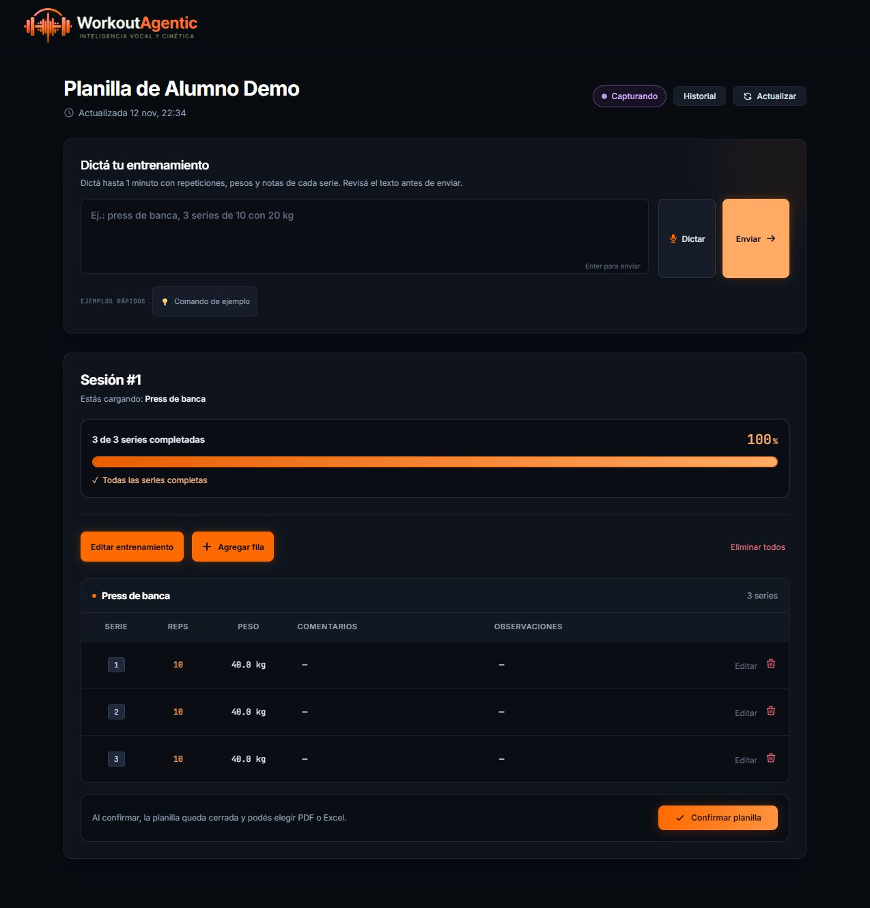
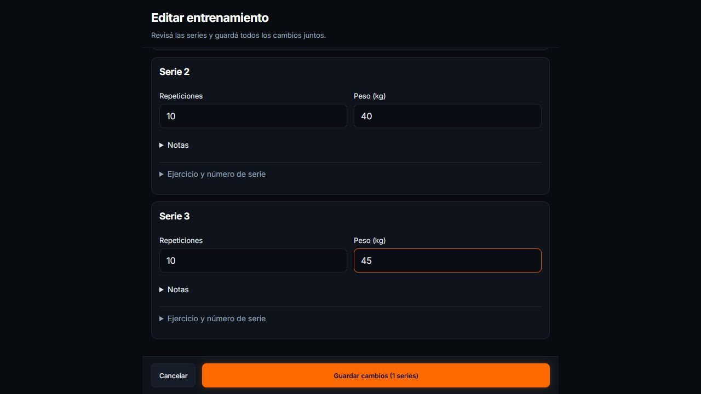
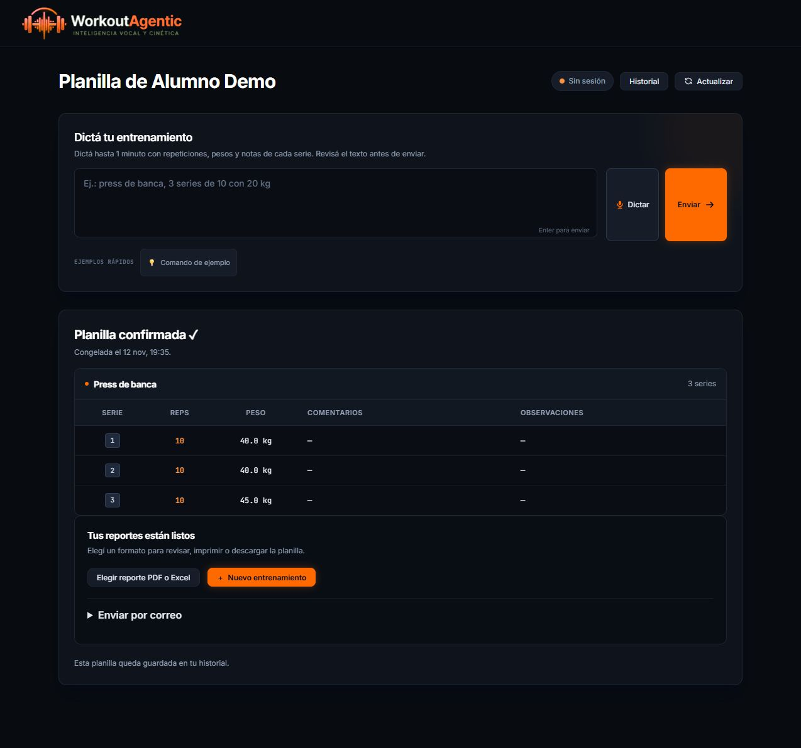
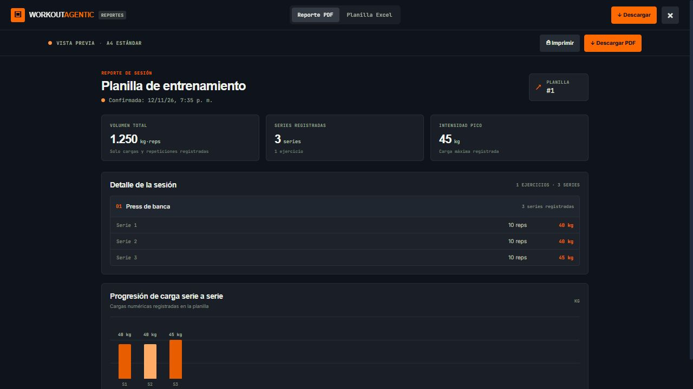

# Product demo walkthrough

Account update (ADR-0038): first open `/registro`, create a synthetic student
account and sign in. `/` now opens that account's own worksheet. The screenshots
below predate authentication and illustrate the unchanged workout flow.

These screenshots show the running Angular SPA connected to the .NET API, using the explicitly created synthetic student **Alumno Demo** in a separate local SQLite database. They are application captures, not design mockups or evidence of real trainee data. The UI intentionally remains in Spanish.

Follow the [setup guide](getting-started.md) first. This walkthrough uses one short live-model request and then exercises editing and confirmation without further interpretation calls. A configured Gemini key and accessible model are required for the initial capture; exact model wording can vary.

## 1. Capture a workout

Open the created student's worksheet and enter:

```text
Press de banca 3 series de 10 repeticiones con 40 kg
```

This means bench press, three sets of ten repetitions at 40 kg. Review the text, then select **Enviar**. With dictation, **Dictar** provides a transcript in the same field for review before sending; the screenshots use typed input and do not certify microphone behavior.



## 2. Review the interpreted sets

For this unambiguous input, check that the exercise card contains three sets, each with 10 repetitions and 40 kg. No comments or observations were supplied, so those cells remain empty. The screenshot below records that result from a live Gemini request.

The progress bar indicates that repetitions and load are complete. It does not confirm the workout automatically.



## 3. Correct a set

Select **Editar entrenamiento**, expand **Press de banca**, and change the third set's weight from 40 to 45. Select **Guardar cambios**. The main worksheet should retain 40 kg for the first two sets and show 45 kg for the third. These are synthetic demonstration values, not training recommendations.



## 4. Confirm and inspect the snapshot

Select **Confirmar planilla**. The app opens the report selector. Use its return control to inspect the frozen worksheet; editing controls are no longer available for this snapshot. It is saved in **Historial**. **Nuevo entrenamiento** starts a new capture flow without deleting the confirmed workout.



From **Elegir reporte PDF o Excel**, select **Ver reporte PDF** or **Ver planilla Excel** to review the report and download its file. Reports use confirmed data. The example report below preserves the 40/40/45 kg loads. Email delivery is optional and was not used for this demonstration.



## Additional evaluation scenarios

- On a new workout, provide an exercise and set count without all repetitions or loads. Check that absent values remain absent, and complete them before advancing to another exercise.
- Try an update with an ambiguous target or contradictory values. Check that the application requests clarification rather than silently choosing values.
- With a deliberately unavailable provider configuration in an isolated environment, check that a failed interpretation leaves the previously recorded rows unchanged.
- Review a confirmed workout from history and compare its PDF/Excel values with the frozen worksheet.

These are suggested checks beyond the illustrated happy path. Automated verification results and the limits of the manual review are recorded in [verification](verification.md).
